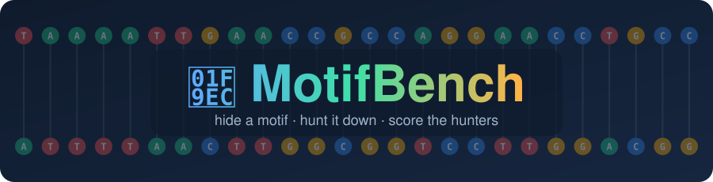
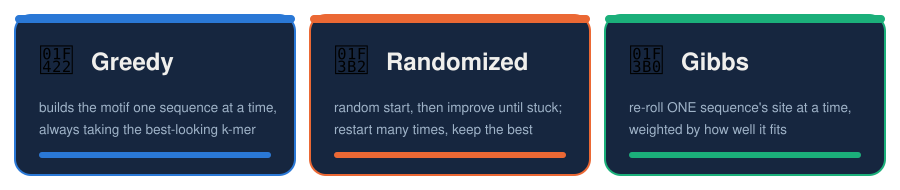
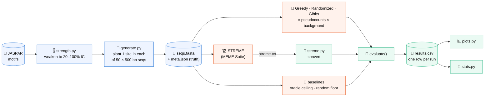
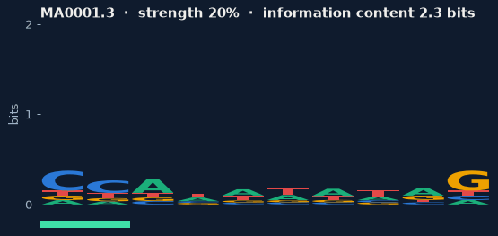

<div align="center">



### *Can textbook motif finders keep up with the professionals?*

We hide transcription-factor binding motifs inside DNA, then let **Greedy**, **Randomized** and **Gibbs** search go hunting for them, and race them against **STREME**.


[🚀 Quick start](#-quick-start-60-seconds) ·
[🗺️ How it works](#️-how-it-works) ·
[📏 Metrics](#-how-we-score-a-motif) ·
[📊 Plots & stats](#-plots--statistics) ·
[👩‍💻 Team](#-who-built-what) ·
[❓ FAQ](#-faq--fun-facts)

</div>

---

## 🎯 The question

A **motif** is a short DNA pattern (around 10 letters) that a protein recognises. It's never identical twice:

```text
seq 1  ...GTTACGCCATATATAGTTCAGA...
seq 2  ...AACCATAAATAGGCTTTGACCG...      ← same motif, a couple of letters off
seq 3  ...TTGATCCCATATATGGAACGTT...
                ^^^^^^^^^^
               CCATATATAG   (the "consensus")
```

Given 50 sequences of 500 letters each, **find the hidden pattern**. Every method does some version of this, sliding a window along the DNA and scoring each spot:

<p align="center">
  
</p>

We ask:

> 1. **When** is each textbook algorithm reliable? (How strong does the motif have to be?)
> 2. How far behind **STREME** are they?
> 3. How much of that gap is explained by two switches: **pseudocounts** and the **background model**?

---

## 🚀 Quick start (60 seconds)

```bash
git clone https://github.com/aaleenfatima/MotifBench
cd MotifBench
python -m venv .venv
```

<table>
<tr><th>🪟 Windows (PowerShell)</th><th>🐧 macOS / Linux</th></tr>
<tr>
<td>

```powershell
.venv\Scripts\Activate.ps1
```

</td>
<td>

```bash
source .venv/bin/activate
```

</td>
</tr>
</table>

```bash
pip install -r requirements.txt
python -m pytest -q                       # ✅ every test in the repo
python data/generate.py --pilot           # 🧪 45 small pilot datasets
python -m evaluation.sanity_check         # 🔍 metrics on one real dataset
```

<details>
<summary><b>🎮 Want to see the whole pipeline light up? Click here.</b></summary>

<br>

These use **fake algorithms** to exercise every step before the real experiment runs. Nothing they print is a result.

```bash
python -m evaluation.demo_evaluate        # 675 rows -> results/demo_results.csv
python -m evaluation.plots results/demo_results.csv --out results/demo_figures --note "DEMO"
python -m evaluation.stats results/demo_results.csv --out results/demo_stats
```

Then open `results/demo_figures/overlap_rate_vs_strength.png`. Everything named `results/demo_*` is git-ignored, so play freely.

</details>

---

## 🗺️ How it works

### 🏁 Meet the hunters

<p align="center">
  
</p>

…and the champion they're racing: **🏆 STREME** from the MEME Suite.

### 🧪 The pipeline



### 🎚️ Turning the difficulty dial

We make motifs harder to find by blending them with random noise, `P' = (1−α)·P + α·0.25`. Watch a real JASPAR motif (MA0001.3) fade from crystal clear to barely there. The letter height is how much information each position carries:

<p align="center">
  
</p>

> 💡 At 20 % strength even the *true* motif can't reliably pick its own sites out of the background. See the [FAQ](#-faq--fun-facts).

### 🎛️ The experiment grid

| Knob | Values | Why it matters |
|---|---|---|
| 🧬 **Motif** | 8 JASPAR motifs of different widths | some are easier than others |
| 🎚️ **Strength** | 20 · 40 · 60 · 80 · 100 % of the original information content | from barely there to crystal clear |
| 🌍 **Data background** | uniform · AT-rich · Markov (CpG-depleted) | real DNA is not 25/25/25/25 |
| 🧠 **Scoring background** | `uniform` · `shuffled` | does the algorithm know what "normal" DNA looks like? |
| ➕ **Pseudocounts** | on · off | stops one unseen letter from scoring −∞ |
| 🔁 **Replicates** | 10–20 per condition | luck is real; we measure it |

---

## 📂 Project map

```text
MotifBench/
├── 🧬 data/            JASPAR download, strength control, dataset generators      
├── 🔎 algorithms/      Greedy, Randomized, Gibbs + pseudocount/background switches  
├── 📏 evaluation/      metrics, STREME conversion, plots, statistics                
├── ⚙️ experiments/     the runner that loops over the whole grid                    
├── 📓 notebooks/       exploration
├── 📊 results/         results CSVs and figures (demo_* is git-ignored)
├── 🎨 docs/            README graphics + the script that draws them
└── requirements.txt
```

---

## 📏 How we score a motif

Every run, whether ours, STREME's or a baseline's, goes through one function, so all methods are judged identically:

```python
from evaluation.evaluate import load_dataset, evaluate, append_results
from algorithms.motif_search import gibbs_sampler

seqs, meta = load_dataset("data/synthetic/MA0001.3_f0.6_uniform_rep0")
found = gibbs_sampler(seqs, k=meta["width"], background="shuffled", pseudocount=True, seed=0)
row = evaluate(found, meta, algorithm="gibbs", bg_model="shuffled", pseudocount=True, seed=0)
append_results("results/results.csv", [row])
```

<details>
<summary><b>🔤 Hamming distance</b>: <i>how many letters are wrong?</i></summary>

<br>

Compares the found consensus with the true one, **sliding it and trying both DNA strands**. A motif found one base to the right isn't punished for the shift, only for the positions it misses.

```text
true    GATTACAGGC
found    ATTACAGGCT     → shifted by 1 → distance 1 (one true letter uncovered)
found   GCCTGTAATC     → reverse strand → distance 0 ✨
```
</details>

<details>
<summary><b>📈 Pearson correlation</b>: <i>does the whole matrix have the right shape?</i></summary>

<br>

Correlates the found 4×k probability matrix with the true one at the best shift and strand. `1.0` = same shape. **Chance is not 0**: a random motif scores about 0.2–0.5 because we keep the best of many alignments. That's why every plot shows a chance band.
</details>

<details>
<summary><b>🎯 Site recovery</b>: <i>did it point at the right place?</i></summary>

<br>

| Flavour | Counts a site as found when… | Use it for |
|---|---|---|
| `exact_rate` | start position is exactly right | Greedy / Randomized / Gibbs |
| `overlap_rate` | ≥ 50 % of the planted site is covered | **all methods, including STREME** |
</details>

<details>
<summary><b>🔋 Information content</b>: <i>how strong is the motif?</i></summary>

<br>

Bits per column: `2` = one letter always, `0` = pure noise. Same formula in `data/` and `evaluation/`, so reported strengths match exactly.
</details>

<details>
<summary><b>🏆 Making STREME comparable</b></summary>

<br>

STREME picks its own width, may report the opposite strand and ranks several motifs. We take its **top-ranked** motif (never the one closest to the truth), align widths and strands in the metrics, and scan each sequence with its matrix to get one site per sequence, just like our algorithms.
</details>

---

## 📊 Plots & statistics

```bash
python -m evaluation.plots results/results.csv          # -> results/figures/*.png + summary_table.csv
python -m evaluation.stats results/results.csv          # -> results/stats/*.csv + plain-English summary
```

**Reading a figure.** One panel per *data background × scoring background*:

| Mark | Meaning |
|---|---|
| 🔵 Greedy · 🟠 Randomized · 🟢 Gibbs | fixed colours in every figure (colour-blind checked) |
| ━━ solid / ╌╌ dashed | pseudocounts **on** / **off** |
| ⚫ dash-dot | STREME |
| ⋯ grey dotted | **ceiling**: scanning with the true motif itself |
| ▒ grey band | **chance**: random sites |

**The statistics.** Paired Wilcoxon signed-rank tests (same datasets, A vs B), a rank-biserial effect size, and Holm correction across all claims. `stats.py` also reports **how much of the gap to STREME** pseudocounts + background close, and the **lowest strength** at which each method becomes reliable.

---

## 👩‍💻 Who built what

| | Person | Owns |
|:-:|---|---|
| 🔎 | **Aaleen** | Algorithms: Greedy, Randomized, Gibbs, pseudocounts, log-odds background scoring |
| 🧬 | **Laiba** | Data & pipeline: JASPAR, strength control, planted & real-site datasets, STREME runs, experiment runner |
| 📏 | **Mariyam** | Evaluation & analysis: metrics, STREME conversion, plots, statistics, results write-up |

### 🛣️ Progress

- [x] JASPAR motifs + strength control + planted datasets
- [x] Real-site datasets (JASPAR sites in synthetic flanks)
- [x] Greedy · Randomized · Gibbs with both switches
- [x] Metrics, STREME conversion, plots, statistical tests
- [ ] STREME runs (MEME Suite on Linux / WSL)
- [ ] Experiment runner over the full grid
- [ ] Full runs → figures → report & slides

---

## ❓ FAQ & fun facts

<details>
<summary><b>🤯 Even the <i>perfect</i> matrix can't find weak motifs. Wait, what?</b></summary>

<br>

At 20 % strength, scanning each sequence with the **true** motif finds the planted site only ~6–8 % of the time: random background windows simply score higher. That's the dotted **ceiling** line. No algorithm can beat it, so a weak result there isn't a bug, it's biology plus statistics.
</details>

<details>
<summary><b>🎲 Why does a random motif score Pearson ≈ 0.5 on AT-rich DNA?</b></summary>

<br>

Our example motif `CCATATATAG` is mostly A/T. Random chunks of AT-rich DNA already look a bit like it. Chance level **depends on the background**, which is exactly why the background model is one of our switches.
</details>

<details>
<summary><b>📐 Why are <code>pearson_true</code> and <code>pearson_jaspar</code> always equal on synthetic data?</b></summary>

<br>

Weakening is `(1−α)·P + α·0.25`, a linear rescaling, and Pearson correlation ignores linear rescaling. A tidy bit of maths that saves a plot.
</details>

<details>
<summary><b>🧪 How do I run only one part's tests?</b></summary>

<br>

```bash
python -m pytest algorithms -q
python -m pytest evaluation -q
```
</details>

<details>
<summary><b>🎨 How were these animations made?</b></summary>

<br>

No external services: they're plain SVG files with CSS animations (GitHub plays them inside ``) and a GIF drawn with matplotlib from real JASPAR data. Rebuild them any time:

```bash
python docs/make_readme_art.py
```
</details>

<details>
<summary><b>🤝 Contributing rules</b></summary>

<br>

- One branch (`main`): **always `git pull` before you start and before you push**
- Nucleotide order is **A, C, G, T** everywhere; profiles are `4 × k`
- Every result row stores its seed, so any run can be reproduced
- New package? Add it to `requirements.txt` in the same commit
</details>

---

<div align="center">

*Built with 🧬, ☕ and a lot of `np.log2`*

**References:** Compeau & Pevzner, *Bioinformatics Algorithms*, Ch. 2 · JASPAR · Bailey (2021), *STREME*, Bioinformatics

</div>
