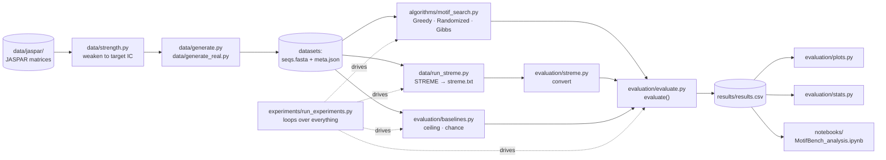

# 📚 MotifBench Study Guide

*Everything you need to understand, explain and defend this project: the ideas, every folder, every file, the results, and the questions you are likely to be asked.*

**How to use this guide**

1. Read **Part 1** (the big picture) and **Part 2** (key concepts) first. Everything else builds on them.
2. Use **Part 4** as a reference: one entry per file, saying what it does, its key functions and how it connects to the rest.
3. Memorise the numbers in **Part 5** and practise the questions in **Part 6** before the presentation.
4. Test yourself with the quiz in **Part 8**; answers are hidden until you click.

**Contents**

- [Part 1 · The big picture](#part-1--the-big-picture)
- [Part 2 · Key concepts](#part-2--key-concepts)
- [Part 3 · How the pieces fit together](#part-3--how-the-pieces-fit-together)
- [Part 4 · File by file](#part-4--file-by-file)
  - [4.1 data/](#41-data--laiba) · [4.2 algorithms/](#42-algorithms--aaleen) · [4.3 experiments/](#43-experiments--laiba--aaleen) · [4.4 evaluation/](#44-evaluation--mariyam) · [4.5 results/, notebooks/, report/, docs/](#45-results-notebooks-report-docs-and-root-files)
- [Part 5 · Results cheat sheet](#part-5--results-cheat-sheet)
- [Part 6 · Questions you will be asked](#part-6--questions-you-will-be-asked)
- [Part 7 · Running everything](#part-7--running-everything)
- [Part 8 · Self-test quiz](#part-8--self-test-quiz)

---

## Part 1 · The big picture

**The biology.** Transcription factors are proteins that switch genes on and off by binding short DNA patterns (6–20 bases) called **motifs**. No two copies of a motif are identical, and they hide inside long stretches of unrelated DNA.

**The computational problem.** Given 50 DNA sequences, each with one hidden copy of an unknown motif, find where each copy is and what the motif looks like.

**What we compared.**

| Classic (textbook) | Modern |
|---|---|
| Greedy Motif Search | STREME (MEME Suite) |
| Randomized Motif Search | |
| Gibbs Sampling | |

**What we varied** (the "experimental variables" from the proposal):

| Variable | Values |
|---|---|
| Motif strength | 20, 40, 60, 70, 80, 90, 100 % of the motif's original information content |
| Background model (what the algorithm assumes "normal" DNA looks like) | uniform (25 % each base) · shuffled (estimated from the input) |
| Pseudocounts | off (raw counts) · on (Laplace +1) |
| *Also:* how the DNA was generated | uniform · AT-rich · Markov |

**The three research questions and their answers.**

| Question | Answer in one line |
|---|---|
| 1. When is each classic algorithm reliable? | With good settings, Randomized and Gibbs find half the sites at 60–80 % strength. Below ~60 % nothing can, not even the true motif. |
| 2. How far behind STREME are they? | With textbook settings, very far: 4–11 % of sites vs STREME's 38 %. |
| 3. How much of the gap is due to pseudocounts + background? | All of it. Both fixes give ~50 %, above STREME (with the caveat that our algorithms were told the motif width). |

---

## Part 2 · Key concepts

Know each of these well enough to explain it in two sentences.

### Motif and position probability matrix (PPM)
A motif is described as a **4 × k matrix**: rows are A, C, G, T (always in that order in this project), columns are the k positions, and each column sums to 1. Entry `P[b, j]` is the probability of base *b* at position *j*. In code this is called a **profile**.

```text
position:   1     2     3
A        0.90  0.05  0.10
C        0.05  0.05  0.80
G        0.00  0.85  0.05
T        0.05  0.05  0.05
consensus:  A     G     C      ← most likely base in each column
```

### k-mer and site
A **k-mer** is any substring of length k. A **site** is the k-mer where a motif copy actually sits. The algorithms choose one k-mer per sequence; the set of chosen k-mers defines a profile.

### Consensus
The string of the most likely base in each column (e.g. `CCATATATAG`). Used by the Hamming metric.

### Entropy and information content (IC)
For one column, **Shannon entropy** H = −Σ p·log₂(p). It is 0 bits if one base always appears (fully conserved) and 2 bits if all four are equally likely (pure noise). **Information content** = 2 − H per column, summed over all columns. A motif's IC measures how strong, or how easy to spot, it is. A sequence logo draws letter heights proportional to IC.

### Motif strength (how we control difficulty)
We blend each JASPAR matrix with noise: **P′ = (1 − α)·P + α·0.25**. α = 0 leaves the motif unchanged; α = 1 gives pure noise. We choose α by **bisection** so that the blended motif keeps exactly 20 %, 40 %, … of its original IC. Strength is therefore *relative to each motif*.

### Background
The DNA around the motif. We generate three kinds:
- **uniform**: 25 % of each base
- **AT-rich**: A = T = 35 %, C = G = 15 %
- **Markov**: each base depends on the previous one; C→G is depleted (0.10), like CpG depletion in real genomes

### Background *model* (different from the background!)
What the *algorithm assumes* the background is when scoring. **uniform**: bg = 0.25 per base. **shuffled**: shuffle the input sequences and count base frequencies. Shuffling keeps the composition, so this equals **the input's own A/C/G/T frequencies**. The CSV keeps the two apart: `data_bg` (how the DNA was made) vs `bg_model` (what the algorithm assumed).

### Log-odds score
How well a window *x* fits a profile *P*, compared with background:

```text
score(x) = Σ_j log( P[x_j, j] / bg[x_j] )
```

Positive = looks more like the motif than like background. The textbook versions use a consensus score with no background; we replaced it with log-odds so the background model can matter.

### Pseudocounts (Laplace)
Without them, a base never seen at a position has probability 0, so log(0) = −∞ and any window containing it is ruled out completely. Laplace add-one: **P = (count + 1) / (n + 4)**. No zeros, ever.

### Reverse complement and strands
DNA is double-stranded. The motif `GATTACA` on one strand reads `TGTAATC` on the other (reverse the order, swap A↔T and C↔G). STREME may report either strand, so our metrics try both. Neat trick: with rows in A,C,G,T order, the reverse complement of a profile is just `P[::-1, ::-1]`.

### Alignment (shifts)
A found motif may be correct but shifted by a few bases, or (for STREME) a different width. Metrics slide the found motif along the true one on both strands and keep the best placement, requiring at least **75 %** of the shorter motif to overlap.

### Paired Wilcoxon signed-rank test
Compares two settings **on the same datasets** (for example Gibbs with vs without pseudocounts on dataset #17). Pairing removes the huge difference between easy and hard datasets. It is non-parametric, so it does not assume normality, which suits bounded (0–1) skewed metrics.

### Effect size r (rank-biserial)
How big and how consistent a difference is, from −1 to +1. |r| ≈ 0.1 small, 0.3 medium, ≥ 0.5 large. r = 1.00 means the better setting won on every single non-tied dataset.

### Holm correction
Testing 15 claims at p < 0.05 would give about one false "significant" result by luck. Holm adjusts the p-values for multiple testing; it is less strict than Bonferroni but still safe.

### 95 % confidence interval
mean ± 1.96 × standard error. The error bars on every figure.

### Ceiling and chance baselines
- **Ceiling (`oracle_scan`)**: scan each sequence with the *true* matrix and take the best window. No method can locate sites better than the truth itself.
- **Chance (`random`)**: random sites. Note chance Pearson is **not 0** (≈ 0.2–0.5) because we keep the best of many shifts and strands.

---

## Part 3 · How the pieces fit together



**The three fixed interfaces** (agreed at the start so everyone could work in parallel):

1. **Dataset** = a folder with `seqs.fasta` (the sequences) and `meta.json` (the truth: planted positions, true matrix, motif ID, strength, background, seed).
2. **Algorithm** = `f(seqs, k, background, pseudocount, seed) → {positions, profile, consensus}`.
3. **Result** = one CSV row per run with fixed columns (`evaluation/evaluate.py: RESULT_COLUMNS`).

**Conventions used everywhere:** nucleotide order A, C, G, T; profiles are 4 × k NumPy arrays; every run stores its seed.

---

## Part 4 · File by file

### 4.1 `data/` · Laiba

| File | What it does |
|---|---|
| `jaspar_download.py` | Downloads the 10 candidate JASPAR matrices from the JASPAR REST API (`jaspar.elixir.no`) into `data/jaspar/`. Skips files already present. Needs the `requests` package. |
| `jaspar/*.jaspar` | The downloaded count matrices (10 files; 8 are used). |
| `jaspar_loader.py` | `load_motif(path)` reads a matrix with Biopython. `get_ppm(m)` turns counts into a 4 × k probability matrix. `information_content(ppm)` = Σ(2 − entropy). `summarize()` prints width and IC of every motif (run it to choose motifs). Defines `BASES = "ACGT"`. |
| `selected_motifs.py` | The list of the 8 motifs actually used: MA0001.3, MA0002.2, MA0003.4, MA0007.3, MA0009.2, MA0014.3, MA0017.2, MA0018.4. (MA0004.1 and MA0006.1 were downloaded but not used; both are only 6 bp wide. Ask Laiba for the exact selection reasoning.) |
| `strength.py` | `blend(ppm, α)` = (1−α)P + α·0.25. `ppm_at_fraction(ppm, f)` finds α by **bisection** (60 halvings) so that IC = f × original IC, and returns the blended matrix, α and the achieved IC. `STRENGTH_FRACTIONS` = the levels. Run directly, it prints a table of α and IC per motif and level. |
| `generate.py` | Builds the **synthetic datasets**. `BACKGROUNDS` holds three 4 × 4 Markov transition matrices (uniform, AT-rich, Markov). `make_background()` samples DNA from a chain; `sample_site()` samples one site column by column from the profile; `make_dataset()` makes 50 × 500 bp sequences, overwrites one site per sequence at a random position, and writes `seqs.fasta` + `meta.json`. The seed comes from `crc32(dataset name)`, so every dataset can be regenerated exactly. `--pilot` makes only MA0001.3 with 3 replicates (45 datasets). Output in `data/synthetic/` (git-ignored). |
| `generate_real.py` | Builds the **real-site datasets**: reads the JASPAR binding-site FASTA files in `data/real/`, keeps sites of the right length with only A/C/G/T, draws 50 without replacement and embeds them in synthetic flanks. 3 motifs × 3 flank types × 10 replicates = 90 datasets in `data/real_datasets/` (git-ignored). `meta.json` has `data_type = "real_sites"` and placeholder strength 1.0. |
| `real/*_sites.fasta` | Real binding sites from JASPAR 2026 for MA0003.4 (TFAP2A), MA0014.3 (PAX5), MA0018.4 (CREB1). |
| `check_dataset.py` | Sanity check for one dataset folder: compares the target IC with the empirical IC of the planted sites, and prints the base composition. |
| `run_streme.py` | Runs **STREME** on every dataset (Linux/WSL, MEME Suite installed): `streme --p seqs.fasta --dna --maxw 20`, in parallel and resumable. Saves each run's `streme.txt` in `results/streme_raw/` (git-ignored) and summarises the top motif of each dataset in `results/streme_summary.csv` and `results/streme_top_motifs.json`. `--maxw 20` because STREME's default maximum width (15) is narrower than two of our motifs (16 and 17 bp). |

### 4.2 `algorithms/` · Aaleen

**`motif_search.py`**: the three algorithms, sharing helper code.

| Piece | What it does |
|---|---|
| `_encode`, `_LUT` | Turns `"ACGT"` strings into integer codes 0–3 with a lookup table (fast; rejects other letters). |
| `_Data` | Precomputes, for every sequence, the index of every k-mer window, so scoring all windows becomes one NumPy operation. `counts(pos)` gives the 4 × k counts of the chosen k-mers. Handles sequences of different lengths. |
| `_background(codes, mode, rng)` | `"uniform"` → [0.25]×4. `"shuffled"` → base frequencies of a shuffled copy of the input. |
| `_profile(counts, n, pseudocount)` | Laplace (c+1)/(n+4) if pseudocounts on, else c/n. |
| `_log_odds(profile, log_bg)` | log(P) − log(bg); −∞ where P = 0. |
| `_set_score(...)` | Score of a whole motif set: Σ count × log-odds. Zero-count terms contribute 0, so the score is always finite. |
| `_best_windows(data, log_odds)` | Best-scoring window in every sequence at once. |
| `greedy_motif_search` | For every k-mer of sequence 1 as a seed: build a profile from the k-mers so far, pick the best k-mer in the next sequence, repeat; keep the best set. Deterministic. |
| `randomized_motif_search` | Random k-mers → profile → best k-mer per sequence → profile … until the score stops improving. `n_restarts` = 200 in the experiment. |
| `gibbs_sampler` | Random k-mers; repeatedly drop one sequence's k-mer, rebuild the profile from the rest, and **sample** a new window with probability ∝ P(window)/bg(window). Keeps the best set seen. 40 restarts × 2,000 iterations in the experiment. |
| `ALGORITHMS` | Dict name → function, used by the runner. |
| Zero handling | With pseudocounts off: a window with an impossible base scores −∞; if *every* window in a sequence is −∞, take the first window (Greedy/Randomized) or sample uniformly (Gibbs). This is why Greedy without pseudocounts collapses. |
| Paired seeds | The background estimate uses its own random generator, so uniform and shuffled runs with the same seed start from identical random numbers. |

**`test_algorithms.py`**: tests for every algorithm: a very strong motif is recovered; output has the agreed format; same seed gives the same result; pseudocounts off has zeros and on does not; all-zero-probability windows do not crash; sequences of different lengths work; the shuffled background differs from uniform on skewed data; bad input raises an error; the textbook Greedy example from Compeau & Pevzner gives the textbook answer.

### 4.3 `experiments/` · Laiba & Aaleen

| File | What it does |
|---|---|
| `run_experiments.py` | **The main runner.** For every dataset: 3 algorithms × 2 background models × 2 pseudocount settings = 12 runs, plus STREME (read from `streme.txt`), plus the ceiling and chance baselines = **15 rows per dataset**. Every run is scored with `evaluate()` and appended to `results/results.csv`. Runs in parallel processes (`--workers`), one NumPy thread per process; **resumable** (finished datasets are skipped); the same seed is used for every setting of a dataset, so comparisons are paired. A failed STREME output is recorded as a failed row, not a crash. `--fill-streme` adds STREME rows later. Saves the run configuration (budgets, versions, git commit) to `results/run_config*.json`. |
| `budget_study.py` | Reruns Randomized and Gibbs with growing budgets on a few datasets and records `search_ok` = did the search find a motif set that scores **at least as high as the planted sites**? If yes but recovery is still low, more search cannot help: the scoring model prefers the wrong answer. Output: `results/budget_study.csv`. |
| `test_run_experiments.py` | Builds one small dataset in a temp folder and checks: every method and setting appears; missing STREME output is reported, not fatal; the same seed is used for every setting; runs are reproducible; metrics are in range; resume works. |

### 4.4 `evaluation/` · Mariyam

**`metrics.py`**: the measuring instruments.

| Function | What it does |
|---|---|
| `check_profile(P)` | Validates a 4 × k profile with columns summing to 1. |
| `revcomp_str(s)` / `revcomp_profile(P)` | Reverse complement of a string / a profile (`P[::-1, ::-1]`). |
| `consensus(P)` | Most likely base per column. |
| `profile_from_sites(sites, pseudocount)` | Builds a profile from a list of equal-length sites. |
| `column_entropy(P)` / `information_content(P)` | Shannon entropy per column / total IC = Σ(2 − H). Same formula as `data/jaspar_loader.py`, so numbers match. |
| `_placements(kf, kt, min_overlap)` | Every shift of a width-kf motif along a width-kt motif with enough overlap. |
| `hamming_aligned(found, true)` | Best Hamming distance over shifts and both strands. Distance = mismatches in the overlap **+ true positions left uncovered**, so a correct motif shifted by 1 scores 1, not 10. Returns distance, normalised distance, offset, strand. |
| `pearson_aligned(found, true)` | Best Pearson r between the flattened overlapping columns, over shifts and strands. NaN if a profile is all-uniform (no variance). |
| `site_overlap(...)` / `site_recovery(found_pos, true_pos, k_found, k_true, min_frac=0.5)` | Share of sequences whose planted site was found: `exact_rate` (same start), `overlap_rate` (≥ 50 % of the site covered, **the main metric**), `mean_overlap`. A `None` position (no prediction) counts as a miss. |

**`evaluate.py`**: the single entry point every runner uses.

| Function | What it does |
|---|---|
| `load_dataset(folder)` | Reads `seqs.fasta` + `meta.json`. |
| `evaluate(found, meta, algorithm, bg_model, pseudocount, seed, runtime_s)` | Runs every metric against the truth and returns **one CSV row** with the fixed `RESULT_COLUMNS`, floats rounded to 4 decimals. `found=None` (method reported nothing) gives a failed row with recovery 0, so failures count in the averages. |
| `append_results(path, rows)` | Appends rows to a CSV, writing the header only once. |
| `RESULT_COLUMNS` | The agreed column order: what was run, which dataset, what was found, the metrics. |

**`streme.py`**: makes STREME comparable.

| Function | What it does |
|---|---|
| `parse_meme(path)` | Reads STREME's `streme.txt` (MEME text format): every motif (ID, width, nsites, score, 4 × w profile) and the background frequencies. |
| `best_site(seq, profile, background)` | Best log-odds window in a sequence, on both strands. |
| `streme_to_found(meme_path, seqs)` | STREME output → the same `found` dict as our algorithms. Uses the **top-ranked** motif (never the one closest to the truth: that would be cheating) and scans every sequence for one site per sequence. `None` if STREME found nothing. |
| `write_meme(path, profiles)` | The reverse: writes profiles in MEME format (used in tests and demos). |

**`baselines.py`**: `oracle_scan(seqs, meta)` (ceiling: scan with the true matrix) and `random_motif(seqs, k, seed)` (chance: random positions).

**`plots.py`**

| Function | What it does |
|---|---|
| `load_results(*csvs)` | Reads results, normalises pseudocount to on/off, fills missing `bg_model`, and adds `found_entropy` = 2 − IC/width (bits per position). |
| `mean_ci(df, by, metric)` | Mean, 95 % CI and n per group. |
| `plot_metric(df, metric, out)` | Metric vs strength. Panel columns = DNA background, rows = scoring background, colour = algorithm (fixed: Greedy blue, Randomized orange, Gibbs green; colour-blind checked), solid/dashed = pseudocounts on/off, black = STREME, grey dotted = ceiling, grey band = chance. **Synthetic data only.** |
| `plot_real(df, out)` | Real binding-site figure: one dot per method, four metric panels. |
| `summary_table(df)` | Every metric's mean ± CI per condition (the numbers behind the figures). |
| `make_all(csvs, out_dir)` | Writes all of the above to `results/figures/`. |

**`stats.py`**

| Function | What it does |
|---|---|
| `paired_test(df, metric, factor, a, b, where)` | Paired Wilcoxon test of b vs a, matched on dataset + all other settings. Returns n, means, mean/median difference, wins/losses/ties, p, effect r. |
| `vs_reference(df, metric, alg)` | An algorithm configuration vs STREME on the same datasets. |
| `holm(pvals)` | Holm-adjusted p-values. |
| `standard_claims(df)` | The project's 15 claims in one table: pseudocounts per algorithm, background per algorithm × DNA type, each algorithm vs STREME. |
| `streme_gap(df)` | How much of the gap to STREME the two fixes close (textbook → both fixes). |
| `reliability(df, level)` | Lowest strength at which mean recovery reaches `level`. |
| CLI | `--data-type real_sites` runs everything on the real data separately. |

**Demos and checks** (use fake algorithms or the pilot data; outputs go to `results/demo_*`, which is git-ignored):

| File | What it does |
|---|---|
| `sanity_check.py` | Runs every metric on one pilot dataset with known answers (perfect, shifted, reversed, random). |
| `demo_evaluate.py` | Fake Greedy/Randomized/Gibbs + fake STREME + real baselines on the pilot data → `results/demo_results.csv`. Used to build the plots before real results existed. |
| `demo_streme.py` | Checks the STREME converter with fake STREME files (opposite strand, shorter width), or with a real `streme.txt`. |

**Tests**: `test_metrics.py` (hand-made cases: perfect, shifted, reversed, shorter, random, uniform, recovery), `test_evaluate.py` (row format, failures, rounding, CSV writing), `test_streme.py` (parsing a realistic `streme.txt`, both strands, no-motif case), `test_plots.py` (CI maths, real rows kept out of strength curves, every figure written), `test_stats.py` (a planted effect is detected, no effect is not, Holm values, gap, reliability).

### 4.5 `results/`, `notebooks/`, `report/`, `docs/` and root files

| Path | What it is |
|---|---|
| `results/results.csv` | **The experiment**: 26,550 rows, one per run. |
| `results/run_config*.json` | Search budgets, background models, seed rule, software versions and git commit for the run (the full run was done in stages; each stage's settings are saved). |
| `results/streme_summary.csv`, `streme_top_motifs.json` | STREME's top motif per dataset (width, sites, E-value, consensus, matrix). |
| `results/budget_study.csv` | Output of the budget study. |
| `results/figures/` | The 6 figures + `summary_table.csv`. |
| `results/stats/` | Claims, STREME gap and reliability tables; `real_sites/` holds the same for real data. |
| `notebooks/MotifBench_analysis.ipynb` | The whole analysis in one place, saved with outputs, ending with conclusions. |
| `report/` | Final report (Word + PDF) and presentation slides. |
| `docs/assets/`, `docs/make_readme_art.py` | README animations (SVG + a GIF made from real JASPAR data) and the script that draws them. |
| `docs/STUDY_GUIDE.md` | This guide. |
| `README.md` | Project front page: quick start, pipeline, results. |
| `requirements.txt` | Every Python package needed: `pip install -r requirements.txt`. |
| `.gitignore` | Keeps generated data (`data/synthetic/`, `data/real_datasets/`), raw STREME output, demo results and the virtual environment out of git. |

---

## Part 5 · Results cheat sheet

**Scale:** 8 motifs · 7 strengths · 3 DNA backgrounds · 10 replicates · 1,680 synthetic + 90 real-site datasets · 15 runs each · **26,550 runs** · ~43 CPU-hours · 92 tests.

**Site recovery on synthetic data (mean over everything):**

| Method | Textbook (pc off, uniform bg) | Both fixes (pc on, shuffled bg) |
|---|---|---|
| Greedy | 0.038 | 0.463 |
| Randomized | 0.114 | 0.502 |
| Gibbs | 0.108 | 0.503 |
| STREME | 0.377 | |
| Ceiling / chance | 0.625 / 0.029 | |

**Effects (Δ site recovery, paired Wilcoxon, Holm-corrected):**

| Effect | Δ | r |
|---|---|---|
| Shuffled bg, AT-rich DNA, Randomized | +0.55 | 1.00 |
| Shuffled bg, AT-rich DNA, Gibbs | +0.49 | 1.00 |
| Shuffled bg, Markov DNA, Randomized / Gibbs | +0.32 / +0.30 | 0.92 / 0.90 |
| Shuffled bg, uniform DNA | ≈ 0 | n.s. |
| Pseudocounts, Greedy | +0.31 | 0.89 |
| Pseudocounts, Gibbs / Randomized | +0.14 / +0.10 | 0.83 / 0.82 |

**Real binding sites (both fixes):** Gibbs 0.88 · Randomized 0.88 · Greedy 0.79 · STREME 0.80. Gibbs and Randomized beat STREME (p < 1e-5); Greedy ties (p = 0.12).

**Reliability (strength where recovery reaches 50 %):** ceiling 0.6 everywhere; Gibbs/Randomized with both fixes 0.6–0.8; STREME 0.8–0.9.

**Other findings:**
- At 20 % strength, found motifs have 1.1–1.5 bits/position of entropy vs 1.8 for the true motif: **over-confident**.
- Budget study: 88 % of Randomized runs already score at least as well as the planted sites (model-limited); only 58 % for Gibbs (search-limited, so its results are a lower bound).
- Runtime per dataset: Greedy ~2 s, STREME ~4 s, Randomized ~4 s, Gibbs ~15 s.

**The caveat to always mention:** the classic algorithms were given the true motif width; STREME had to find it.

---

## Part 6 · Questions you will be asked

<details>
<summary><b>Why does the uniform background fail on AT-rich DNA?</b></summary>

With bg = 0.25, every A or T in a window scores as evidence for the motif, because A and T are much more common in the data (35 %) than the model expects (25 %). The best-scoring windows are then simply the most AT-rich ones, and the search converges to junk like `AAATAAAAAT`. Estimating the background from the input cancels this bias.
</details>

<details>
<summary><b>Why does the shuffled background make no difference on uniform DNA?</b></summary>

On uniform DNA the estimated base frequencies are ≈ 0.25 anyway, so both models are almost identical. This is a sanity check that the effect is real, not an artefact.
</details>

<details>
<summary><b>Why does Greedy collapse without pseudocounts?</b></summary>

Greedy builds its first profiles from one or two sequences, so most entries are 0. Without pseudocounts nearly every window in the next sequence contains an impossible base and scores −∞; the code then takes the first window by default, and that error propagates through all remaining sequences. Randomized and Gibbs build profiles from all or all-but-one sequences, so zeros are rarer.
</details>

<details>
<summary><b>Is it fair to compare with STREME?</b></summary>

Mostly: same datasets, same evaluation, STREME's top-ranked motif only, sites found by scanning with its own matrix, metrics that handle its different width and strand. The unfair part: our algorithms were told the true width. And this benchmark has exactly one site per sequence, so STREME's strengths (finding the width, zero or many sites per sequence) are not tested.
</details>

<details>
<summary><b>Why paired Wilcoxon and not a t-test?</b></summary>

Paired, because every setting runs on the same datasets, which removes the large easy-vs-hard variation. Wilcoxon, because the metrics are bounded (0–1), skewed and heavily tied, so normality cannot be assumed.
</details>

<details>
<summary><b>Why is exact-start recovery not used for STREME?</b></summary>

STREME chooses its own width and offset, so its predicted start never equals the planted start, even when it found the right site. We compare STREME with overlap recovery (≥ 50 % covered).
</details>

<details>
<summary><b>What is the ceiling and why does it matter?</b></summary>

Scanning every sequence with the true matrix. Even it finds only half the sites at 60 % strength, because random background windows outscore weak planted sites. So failures below that strength are a limit of the data, not a bug in the algorithms.
</details>

<details>
<summary><b>Why is a random motif's Pearson about 0.4 and not 0?</b></summary>

We report the *best* correlation over many shifts and both strands. Taking the maximum of many noisy values gives a positive number by chance. It is higher on AT-rich DNA for AT-rich motifs because random AT-rich chunks partly resemble them. That is why every figure shows a chance band.
</details>

<details>
<summary><b>Why are pearson_true and pearson_jaspar equal on synthetic data?</b></summary>

The blended matrix is (1−α)P + α·0.25, a linear rescaling of the JASPAR matrix, and Pearson correlation is unchanged by linear rescaling.
</details>

<details>
<summary><b>How do you know the search budgets were large enough?</b></summary>

The budget study. For Randomized, 88 % of runs already find a set scoring at least as high as the planted sites, so more restarts would add little. For Gibbs it is 58 % and still rising, so we say clearly that Gibbs results are a lower bound.
</details>

<details>
<summary><b>How is the experiment reproducible?</b></summary>

Every dataset's seed comes from its name; every result row stores its seed; the run configuration and git commit are saved; `generate.py`, `run_experiments.py`, `plots.py`, `stats.py` and the notebook rebuild everything; 92 tests check the pieces.
</details>

<details>
<summary><b>Why are there extra strength levels at 70 % and 90 %?</b></summary>

The interesting transition, where methods go from failing to working, happens between 60 % and 100 %, so the extra levels give a sharper picture of when each method becomes reliable. (Confirm the exact reasoning with Laiba, who set up the levels.)
</details>

<details>
<summary><b>What would you do with more time?</b></summary>

Let the classic algorithms search over widths, add sequences with zero or several sites, use genomic instead of synthetic flanks, use a higher-order (dinucleotide) background model, increase the Gibbs budget, and add more motifs.
</details>

---

## Part 7 · Running everything

From the repository root, with the virtual environment active:

```bash
pip install -r requirements.txt
python -m pytest -q                                   # 92 tests

# data
python data/jaspar_download.py                        # matrices (already in the repo)
python data/generate.py                               # 1,680 synthetic datasets  (--pilot: 45)
python data/generate_real.py                          # 90 real-site datasets
python data/run_streme.py --workers 4                 # STREME, Linux/WSL only

# experiment
python -m experiments.run_experiments --workers 4     # all 26,550 runs (hours; resumable)
python -m experiments.budget_study                    # budget study

# analysis
python -m evaluation.plots results/results.csv
python -m evaluation.stats results/results.csv
python -m evaluation.stats results/results.csv --data-type real_sites
code notebooks/MotifBench_analysis.ipynb              # everything in one place
```

Quick checks without the full run: `python data/generate.py --pilot`, then `python -m evaluation.sanity_check` and `python -m evaluation.demo_evaluate`.

---

## Part 8 · Self-test quiz

<details><summary>1. What are the rows and columns of a profile in this project?</summary>Rows A, C, G, T (in that order); columns are the k motif positions; each column sums to 1.</details>

<details><summary>2. What is the IC of a fully conserved 10-bp motif? Of pure noise?</summary>20 bits (2 per position). 0 bits.</details>

<details><summary>3. What does α = 0.4 do in P′ = (1−α)P + α·0.25?</summary>Keeps 60 % of the original probabilities and mixes in 40 % uniform noise. In practice we never set α directly; we pick it by bisection to hit a target IC fraction.</details>

<details><summary>4. What is the difference between <code>data_bg</code> and <code>bg_model</code>?</summary><code>data_bg</code> is how the DNA was generated (uniform/AT-rich/Markov); <code>bg_model</code> is what the algorithm assumed when scoring (uniform/shuffled).</details>

<details><summary>5. What does the shuffled background actually estimate?</summary>The input's own single-base (A/C/G/T) frequencies, because shuffling preserves composition.</details>

<details><summary>6. What is the reverse complement of GATTACA?</summary>TGTAATC.</details>

<details><summary>7. A found motif is the true one shifted right by 2 bases. What are its Hamming distance and overlap recovery?</summary>Hamming 2 (two true positions uncovered, no mismatches in the overlap). Overlap recovery 1.0 (each site 80 % covered ≥ 50 %), exact recovery 0.</details>

<details><summary>8. Name the 15 runs done on every dataset.</summary>Greedy, Randomized and Gibbs × {uniform, shuffled} × {pseudocounts on, off} = 12, plus STREME, the ceiling (oracle_scan) and chance (random).</details>

<details><summary>9. Which single factor has the largest effect, and how large?</summary>The background model on non-uniform DNA: +0.55 site recovery for Randomized on AT-rich DNA (r = 1.00).</details>

<details><summary>10. Which algorithm depends most on pseudocounts, and why?</summary>Greedy (+0.31): its early profiles are built from one or two sequences, so without pseudocounts almost all windows score −∞.</details>

<details><summary>11. Below what strength can no method reliably locate the sites?</summary>About 60 % of the original IC: even the true matrix only reaches 50 % recovery there.</details>

<details><summary>12. What is the main caveat when saying the classic algorithms beat STREME?</summary>They were given the true motif width; STREME had to discover it.</details>

<details><summary>13. What does Holm correction protect against?</summary>False positives from testing many claims at once.</details>

<details><summary>14. Why does a method that reports no motif get recovery 0 instead of being dropped?</summary>Dropping failures would make that method look better than it is; failures must count in the averages.</details>

<details><summary>15. Which file would you change to add a fourth algorithm, and what must it return?</summary><code>algorithms/motif_search.py</code> (add it to <code>ALGORITHMS</code>); it must return <code>{positions, profile (4 × k), consensus}</code>. The runner, evaluation, plots and stats then work unchanged (add a colour in <code>plots.ALGORITHMS</code>).</details>
